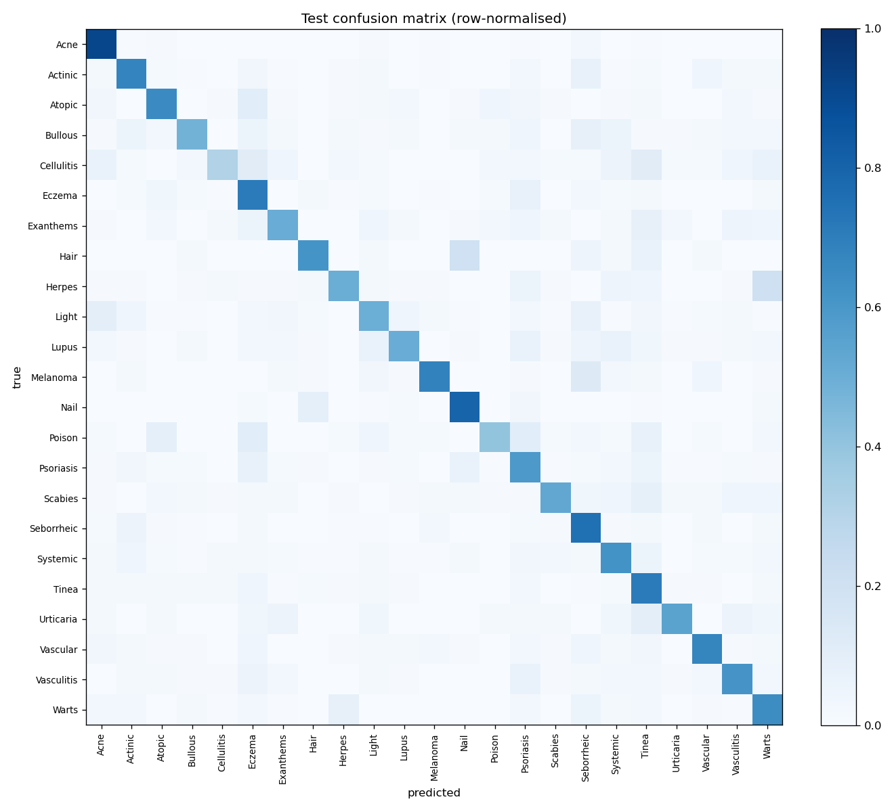
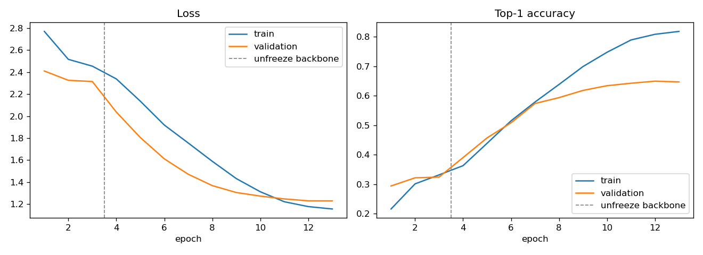

# DermNet Skin-Condition Classifier

Transfer learning on the public [DermNet dataset](https://www.kaggle.com/datasets/shubhamgoel27/dermnet)
(23 skin-condition classes, 15,557 training and 4,002 test images), trained on an Apple M4 GPU with PyTorch.

**Educational project, not a diagnostic tool.**

## Results (held-out test set, 4,002 images)

| Metric | Value |
|---|---|
| Top-1 accuracy | **65.6%** |
| Top-5 accuracy | **90.1%** |
| Macro F1 | 0.611 |
| Weighted F1 | 0.653 |
| Chance (uniform over 23 classes) | 4.3% |

The test set was used exactly once, after training. Checkpoint selection used a separate stratified 10%
validation split of the training folder (best validation macro F1: 0.616 at epoch 12 of 13).

Per-class F1 ranges from **0.39** (Cellulitis / Impetigo, 73 test images) to **0.86** (Acne and Rosacea).
The most common confusions are Herpes/HPV → Warts/Molluscum (21% of that class), Hair loss → Nail disease (20%)
and Melanoma/Nevi → Seborrheic keratoses (13%).
Full numbers are in [`results/classification_report.txt`](results/classification_report.txt) and
[`results/metrics.json`](results/metrics.json).





## Method

- **Model:** EfficientNet-B0 pretrained on ImageNet (torchvision), with a new dropout + linear head over the 23 classes.
- **Input:** 224×224, ImageNet normalisation. Training augmentation: random resized crop, horizontal/vertical flips,
  ±20° rotation, colour jitter.
- **Phase 1 (3 epochs):** backbone frozen; head trained with AdamW, one-cycle LR schedule (max 1e-3).
- **Phase 2 (10 epochs):** whole network fine-tuned with AdamW, one-cycle schedule (max 3e-4), weight decay 1e-4,
  label smoothing 0.1.
- **Hardware:** Apple M4 (16 GB), PyTorch MPS backend, batch size 32. 13 epochs took about 3.5 hours,
  on a GPU shared with other jobs.

## Run

```bash
pip install torch torchvision scikit-learn matplotlib kagglehub
python -c "import kagglehub; print(kagglehub.dataset_download('shubhamgoel27/dermnet'))"
# move the downloaded folder (containing train/ and test/) to data/dermnet
python train.py            # writes results/ and checkpoints/ (weights are not committed)
python train.py --resume   # continue an interrupted run from checkpoints/last.pt
```

## Limitations

- **Class imbalance:** training classes range from 212 images (Urticaria) to 1,405 (Psoriasis). Smaller classes
  have lower recall, which is why macro F1 trails accuracy. No re-weighting or re-sampling was used.
- **Coarse, mixed labels:** many classes are umbrella groups (e.g. "Systemic Disease", "Light Diseases and
  Disorders of Pigmentation"), and several look alike in photos (eczema, atopic dermatitis, contact dermatitis,
  psoriasis). This caps achievable top-1 accuracy.
- **Single run, single seed:** no confidence intervals. Validation accuracy had nearly plateaued (64.97% → 64.72% in
  the final epoch), but longer training, a larger backbone or higher resolution may still help.
- **Dataset bias:** web-sourced clinical photos with varied framing, lighting and skin tones, with no patient-level
  split information. Performance on other populations or real clinical photos is unknown.
- **Not a diagnostic tool.** Do not use it for medical decisions.

## Earlier versions

[`legacy/`](legacy/) holds the original TensorFlow notebooks, kept for reference. Neither produced valid results:

- **v1** applied `rescale=1./255` before Keras `EfficientNetB3`, which already rescales its input internally.
  The images were therefore scaled twice, and validation accuracy stayed at about 8%.
- **v2** trained a 23-way softmax with `binary_crossentropy` and `BinaryAccuracy`. Its reported 95.65% is
  exactly 22/23, the score of a model that predicts "no" for every class.
- Both used the test set for validation and early stopping, and both ran on CPU (about 14 s per step) and were
  stopped during fine-tuning.
