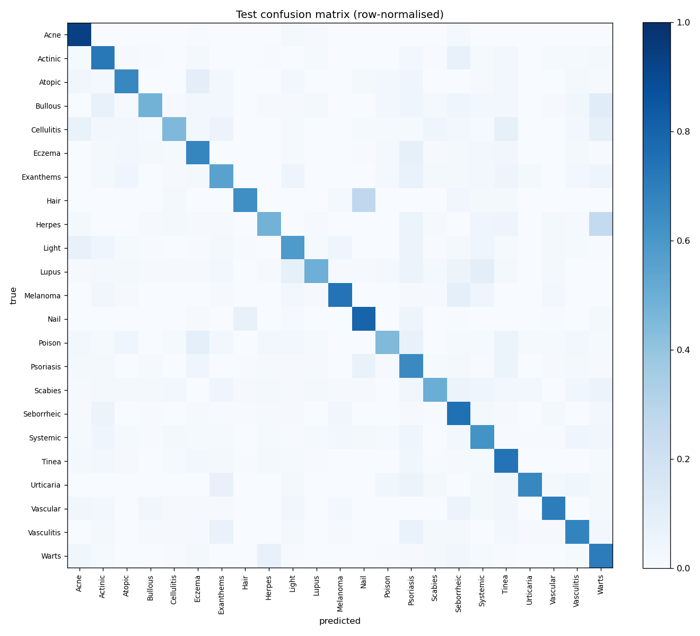
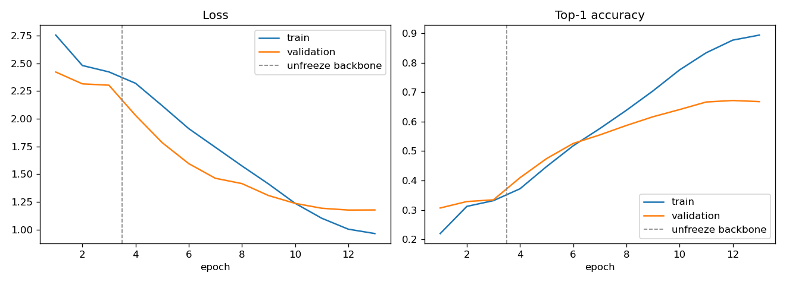

# DermNet Skin-Condition Classifier

Transfer learning on the public [DermNet dataset](https://www.kaggle.com/datasets/shubhamgoel27/dermnet)
(23 skin-condition classes, 15,557 training and 4,002 test images), trained on an Apple M4 GPU with PyTorch.

**Educational project, not a diagnostic tool.**

## Results (held-out test set, 4,002 images)

Two ImageNet-pretrained backbones, trained with the same recipe, data split and seed:

| Backbone | Params | Top-1 acc. | Top-5 acc. | Macro F1 | Weighted F1 |
|---|---|---|---|---|---|
| EfficientNet-B0 | 4.0M | 65.6% | 90.1% | 0.611 | 0.653 |
| **ResNet-50** | 23.6M | **68.4%** | **91.8%** | **0.644** | **0.681** |
| *Chance (uniform)* | | *4.3%* | *21.7%* | | |

The test set was used exactly once per model, after training. Checkpoints were selected on a separate stratified
10% validation split of the training folder. Both models picked epoch 12 of 13.

ResNet-50 has a higher F1 on 20 of the 23 classes. The biggest gains are on Urticaria (0.59 → 0.71) and
Cellulitis / Impetigo (0.39 → 0.50), two of the smallest classes. Its per-class F1 ranges from **0.47**
(Poison Ivy / contact dermatitis) to **0.87** (Acne and Rosacea). The most common confusions are Hair loss → Nail
disease (27% of that class) and Herpes/HPV → Warts/Molluscum (25%).
These are single runs with one seed, so a 3-point gap is suggestive, not a settled ranking.

Full per-class reports, metrics and per-epoch history are in [`results/resnet50/`](results/resnet50/) and
[`results/efficientnet_b0/`](results/efficientnet_b0/).

ResNet-50 confusion matrix and training curves:





## Method

- **Backbones:** torchvision ImageNet weights (EfficientNet-B0 `IMAGENET1K_V1`, ResNet-50 `IMAGENET1K_V2`),
  each with its classifier replaced by dropout (0.3) + a linear layer over the 23 classes. `convnext_tiny` is also
  supported but was not trained (about 1.4× slower per step than ResNet-50 on this machine).
- **Input:** 224×224, ImageNet normalisation. Training augmentation: random resized crop, horizontal/vertical flips,
  ±20° rotation, colour jitter.
- **Phase 1 (3 epochs):** backbone frozen; head trained with AdamW, one-cycle LR schedule (max 1e-3).
- **Phase 2 (10 epochs):** whole network fine-tuned with AdamW, one-cycle schedule (max 3e-4), weight decay 1e-4,
  label smoothing 0.1.
- **Hardware:** Apple M4 (16 GB), PyTorch MPS backend, batch size 32. Each model took about 3.5 hours for
  13 epochs on a GPU shared with other jobs, so the timings are not clean benchmarks.

## Run

```bash
pip install torch torchvision scikit-learn matplotlib kagglehub
python -c "import kagglehub; print(kagglehub.dataset_download('shubhamgoel27/dermnet'))"
# move the downloaded folder (containing train/ and test/) to data/dermnet
python train.py --arch resnet50            # or efficientnet_b0 / convnext_tiny; writes results/<arch>/
python train.py --arch resnet50 --resume   # continue an interrupted run from checkpoints/<arch>/last.pt
```

Model weights are written to `checkpoints/` and are not committed.

## Limitations

- **Class imbalance:** training classes range from 212 images (Urticaria) to 1,405 (Psoriasis). Smaller classes
  have lower recall, which is why macro F1 trails accuracy. No re-weighting or re-sampling was used.
- **Coarse, mixed labels:** many classes are umbrella groups (e.g. "Systemic Disease", "Light Diseases and
  Disorders of Pigmentation"), and several look alike in photos (eczema, atopic dermatitis, contact dermatitis,
  psoriasis). This caps achievable top-1 accuracy.
- **Overfitting:** by the last epoch, training accuracy (89% for ResNet-50) is far above validation accuracy (67%),
  and validation accuracy has stopped improving. Gains would more likely come from stronger regularisation,
  higher resolution or more data than from longer training.
- **Single run, single seed:** no confidence intervals or seed variance.
- **Dataset bias:** web-sourced clinical photos with varied framing, lighting and skin tones, with no patient-level
  split information. Performance on other populations or real clinical photos is unknown.
- **Not a diagnostic tool.** Do not use it for medical decisions.

## Earlier versions

[`legacy/`](legacy/) holds the original TensorFlow notebooks, kept for reference. Neither produced valid results:

- **v1** applied `rescale=1./255` before Keras `EfficientNetB3`, which already rescales its input internally.
  The images were therefore scaled twice, and validation accuracy stayed at about 8%.
- **v2** trained a 23-way softmax with `binary_crossentropy` and `BinaryAccuracy`. Its reported 95.65% is
  exactly 22/23, the score of a model that predicts "no" for every class.
- Both used the test set for validation and early stopping, and both ran on CPU (about 14 s per step) and were
  stopped during fine-tuning.
